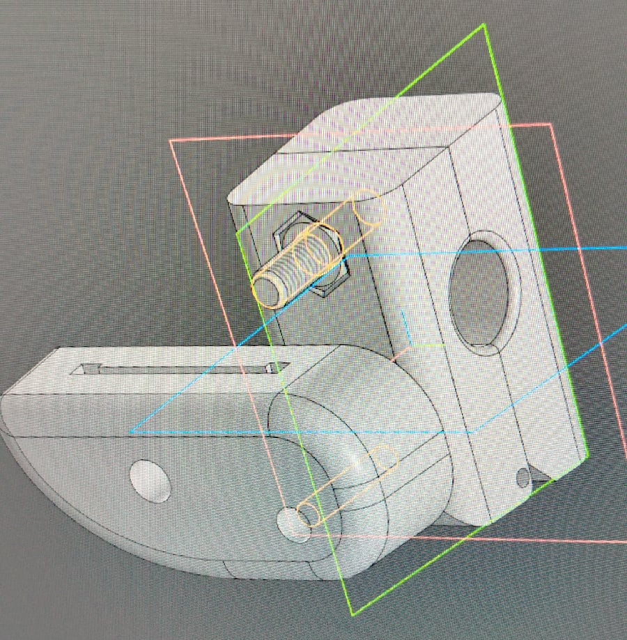

## Оглавление

1. [Проект умных часов](#watch-project)
2. [Технические работы](#other-works)
3. [Шарнир для протеза кота](#sharnir)
   

## Проект умных часов
Подробно можно посмотреть по [ссылке](https://github.com/Artin-cell/TFT-Watch)

<table>
  <tr>
    <td align="center">
      
    </td>
    <td align="center">
      
    </td>
  </tr>
  <tr>
    <td align="center">
      
    </td>
    <td align="center">
      
    </td>
  </tr>
  <tr>
    <td align="center">
      
    </td>
    <td align="center">
      
    </td>
  </tr>
</table>

---

## Некоторые технические работы для дипломов
*Чертежи составлены по 3D моделям, выполненным мною*

<table>
  <tr>
    <td align="center">
      
      
4-ая ось коробки скоростей 16К20

    </td>
    <td align="center">
      
      
Реечная передача коробки подач 6Р82

    </td>
  </tr>
  <tr>
    <td align="center">
      
      
Основание радиально-сверлильного станка 2М55.

    </td>
    <td align="center">
      
      
Шпиндель фрезерного центра VMC1160

    </td>
  </tr>
  <tr>
    <td align="center">
      
      
4-ая ось коробки скоростей станка 1К62

    </td>
    <td align="center">
      
      
Шпиндель сверлильного станка 2Н118

    </td>
  </tr>
</table>

---

## Шарнир для протеза кота
*Оригинальный файл был утерян, других фото нет*
<table>
  <tr>
    <td align="center">
      
  

  </tr>
</table>
