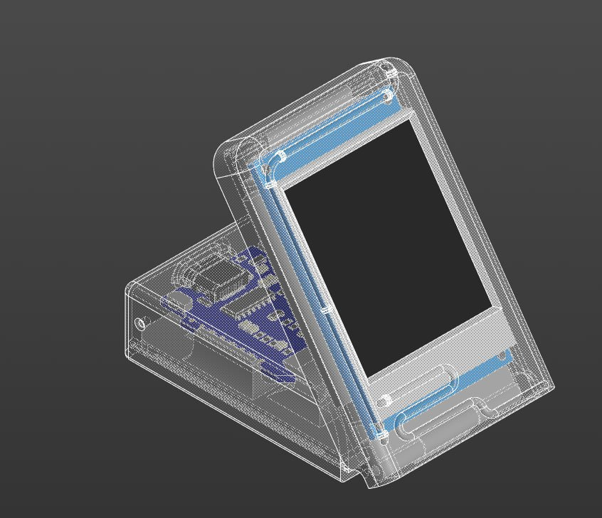
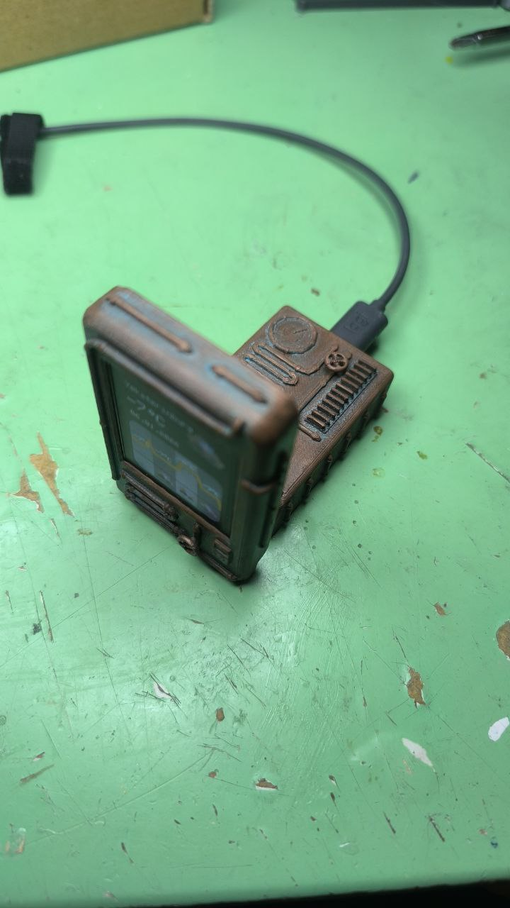
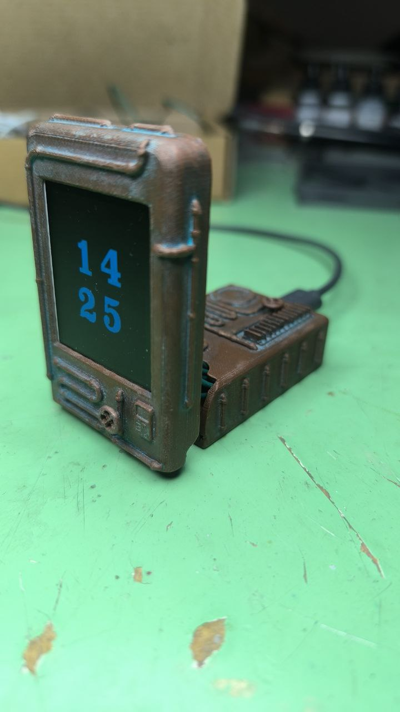
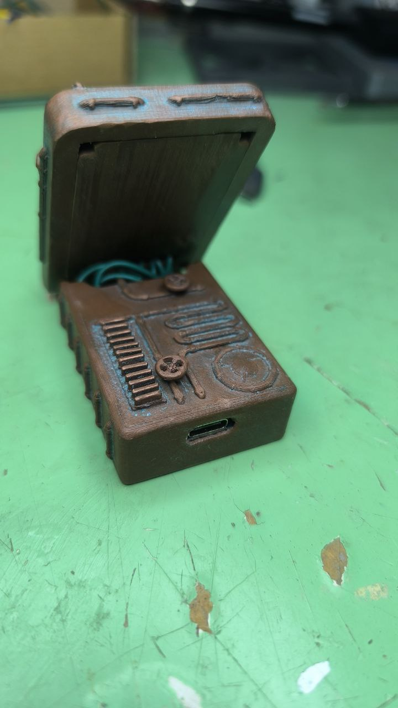
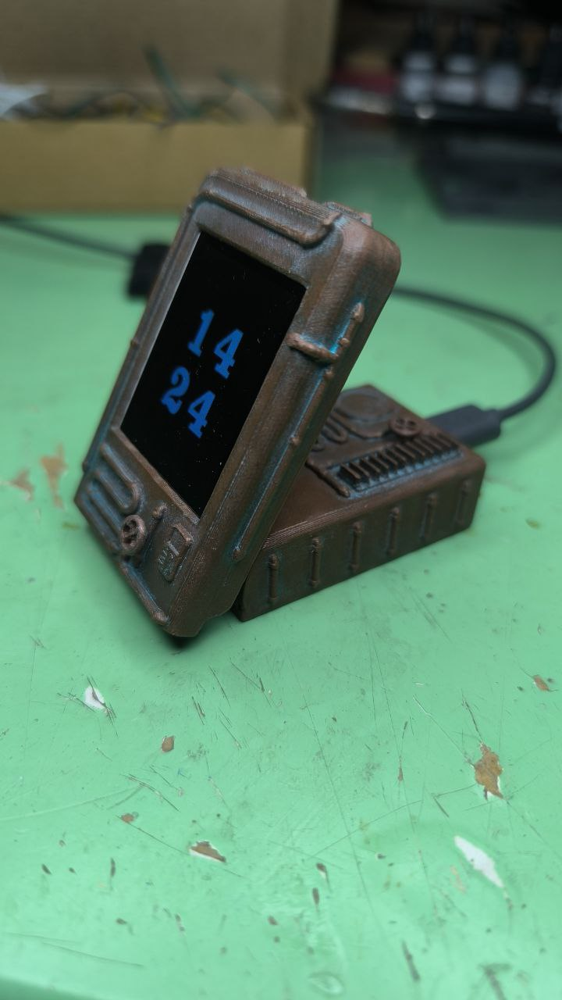
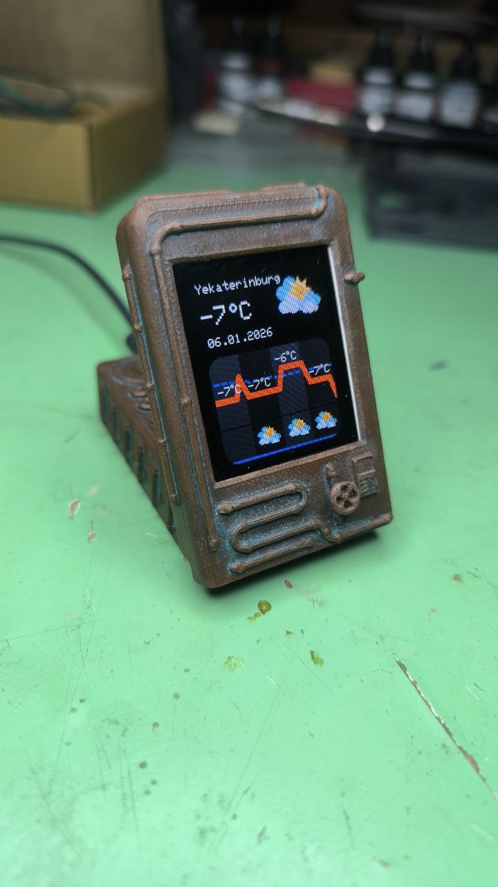
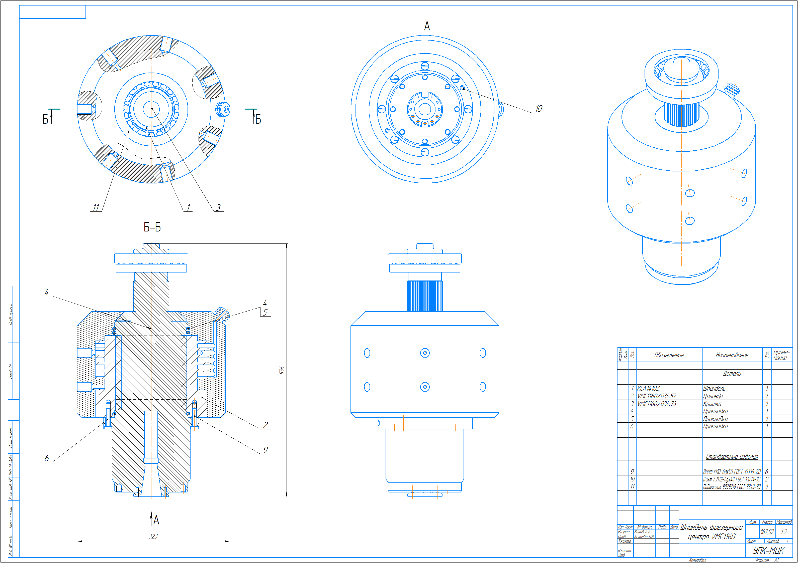
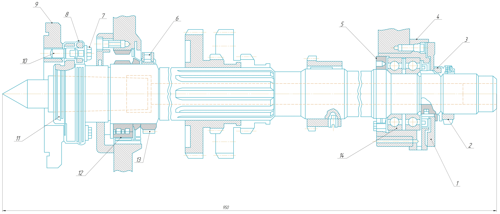

## Оглавление

1. [Проект умных часов](#-проект-умных-часов)
2. [Другие технические работы](#-некоторые-другие-технические-работы)

## Проект умных часов
Подробно можно посмотреть по [ссылке](https://github.com/Artin-cell/TFT-Watch)

<table>
  <tr>
    <td align="center">
      
    </td>
    <td align="center">
      
    </td>
  </tr>
  <tr>
    <td align="center">
      
    </td>
    <td align="center">
      
    </td>
  </tr>
  <tr>
    <td align="center">
      
    </td>
    <td align="center">
      
    </td>
  </tr>
</table>

---

## Некоторые другие технические работы
*Чертежи составлены по 3D моделям, выполненным мною*

<table>
  <tr>
    <td align="center">
      
    </td>
    <td align="center">
      
    </td>
  </tr>
  <tr>
    <td align="center">
      
    </td>
    <td align="center">
      
    </td>
  </tr>
  <tr>
    <td align="center">
      
    </td>
    <td align="center">
      
    </td>
  </tr>
</table>
